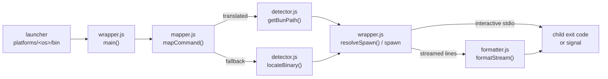

# Architecture

One short-lived process per invocation: no daemon, no shared state. A launcher
in `bunpm/platforms/<os>/bin/` runs `core/wrapper.js` with the manager name and
the untouched arguments; the wrapper then spawns at most one child: Bun or the
original manager.



## Request flow

1. A launcher in `bunpm/platforms/<os>/bin/` (or the `bunpm` bin) runs
   `core/wrapper.js <manager> [args...]`. `wrapper.js doctor` runs
   `core/doctor.js` instead.
2. `mapper.js` validates the arguments and returns Bun arguments or a fallback.
3. `detector.js` resolves Bun (translated) or the original manager (fallback)
   from absolute PATH entries.
4. `wrapper.js` checks the spawn in `resolveSpawn` and starts one child.
   Interactive commands inherit the terminal; others stream through
   `formatter.js` line by line, with SIGINT/SIGTERM forwarded to the child.
5. The child's exit status is returned unchanged; a signal becomes
   `128 + signo`. bunpm's own failures print `bunpm: <component>: <message>`
   and exit 1.

## Modules

- [`core/wrapper.js`](bunpm/core/wrapper.js): entry point. Validates every
  spawn in `resolveSpawn` (absolute executable, argument array, `shell: false`;
  a generic Windows `.cmd`/`.bat` shim runs through an explicit `cmd.exe` and
  rejects shell-sensitive arguments), streams output with error tracking for both
  child output pipes to prevent exit-zero masking, and returns the exit code.
- [`core/mapper.js`](bunpm/core/mapper.js): pure command and flag tables that
  return Bun arguments or a fallback. No I/O. Ambiguity always resolves to
  fallback, never a guess.
- [`core/detector.js`](bunpm/core/detector.js): finds Bun and the original
  managers on absolute PATH entries (then `~/.bun/bin`), skipping bunpm's own
  copies and empty or relative entries.
- [`core/doctor.js`](bunpm/core/doctor.js): `bunpm doctor` health checks
  (Node.js floor, Bun, launchers, original managers).
- [`core/formatter.js`](bunpm/core/formatter.js): line-by-line cosmetic rewrite
  of non-interactive Bun output. Bounded to 64 KiB pending-line memory: oversized
  lines stream directly unformatted to prevent unbounded buffering before EOF.
- [`core/log.js`](bunpm/core/log.js): single diagnostic channel and structured
  multi-level logger (`error`, `warn`, `info`, `debug`). Emits human-readable
  `bunpm: <component>: <message>` stderr lines by default, and schema-valid JSON
  lines under `BUNPM_DEBUG=1`.
- [`core/validate.js`](bunpm/core/validate.js): trust-boundary guards and schema
  patterns (`INPUT_VALIDATION_PATTERNS`, `validateArgs`, `validateManager`,
  `validateBinary`, `validateUrl`).

## Diagnostics & Observability

bunpm is a short-lived CLI utility rather than a long-running service daemon, so
traditional HTTP health endpoints, Prometheus metrics and daemon loggers are not
applicable. Instead, observability is delivered through structured diagnostic
channels and a lightweight logger (`bunpm/core/log.js`):

1. **Human Diagnostic Line (stderr, default)**:
   Every bunpm failure prints `bunpm: <component>: <message>` to stderr so users
   can distinguish wrapper failures from target package manager output.

2. **Structured JSON Diagnostic (stderr, `BUNPM_DEBUG=1`)**:
   When `BUNPM_DEBUG=1` is set in the environment, bunpm emits an additional
   single-line JSON object on stderr for automated CI pipelines and tooling:

   | Field                          | Type             | Description                                                              |
   | ------------------------------ | ---------------- | ------------------------------------------------------------------------ |
   | `timestamp` (`ts`)             | `string`         | ISO 8601 UTC timestamp of the diagnostic event                           |
   | `level`                        | `string`         | Severity level (`"error"`, `"warn"`, `"info"`, `"debug"`)                |
   | `module` (`component`/`scope`) | `string`         | Failing subsystem (`wrapper`, `exec`, `detector`, `doctor`, `bootstrap`) |
   | `message`                      | `string`         | Actionable diagnostic message preserving root cause                      |
   | `code`                         | `string \| null` | System errno code (e.g., `ENOENT`, `EACCES`) or `null` when not set      |

   The logger provides named level methods (`logger.error()`, `logger.warn()`,
   `logger.info()`, `logger.debug()`) and `formatDiagnostic()` conforming to this schema
   with `ts`, `scope`, `message`, and `code`.
   `LOG_LEVELS` is the frozen level contract. Wrapper and doctor failures call
   `logger.error()` explicitly; the standalone bootstrap retains its inline
   diagnostic implementation until the runtime files have been downloaded.

3. **Execution Metrics (`bunpm/core/log.js:metrics`)**:
   bunpm collects lightweight in-memory diagnostic counters (`metrics.increment()`,
   `metrics.gauge()`, `metrics.snapshot()`) tracking command translation
   (`commands_translated`, `commands_fallback`) and environment checks
   (`doctor_checks_total`) with zero external dependencies.

4. **Error Tracking Hook (`bunpm/core/log.js:logger.onError`)**:
   Downstream monitoring agents and tooling can register an error hook
   (`logger.onError(callback)`) to capture structured error diagnostic records
   in-memory. Callback execution is wrapped defensively to prevent monitoring
   failures from interrupting CLI workflows.

Exit codes are preserved verbatim from child processes, with signal terminations
mapped to `128 + signo`. Wrapper-level errors exit with code `1`.

## Boundaries & Dependencies

### Trust Boundaries

bunpm validates runtime arguments through [`bunpm/core/validate.js`](bunpm/core/validate.js).
The standalone bootstrap has its own guards, tested against the same contract:

| Validator                    | Boundary Guarded                                          | Call Sites                                                             | Test Coverage                                                                             |
| ---------------------------- | --------------------------------------------------------- | ---------------------------------------------------------------------- | ----------------------------------------------------------------------------------------- |
| Core `validateArgs(args)`    | Argument arrays without NUL bytes                         | `core/mapper.js:mapCommand`, `core/wrapper.js:resolveSpawn`            | `tests/validation.test.js`                                                                |
| `validateManager(invokedAs)` | Supported package managers (`npm`, `npx`, `yarn`, `pnpm`) | `core/mapper.js:mapCommand`                                            | `tests/validation.test.js`                                                                |
| `validateBinary(binary)`     | Absolute executable binary paths                          | `core/wrapper.js:resolveSpawn`                                         | `tests/validation.test.js`                                                                |
| Core `validateUrl(value)`    | String or URL instance, pinned HTTPS URL                  | Exported validation contract; bootstrap uses its standalone equivalent | `tests/validation.test.js`                                                                |
| Bootstrap guards             | Arguments and pinned HTTPS download URLs                  | `bootstrap.js:main`, `bootstrap.js:download` (initial & redirects)     | `tests/validation.test.js`, `tests/bootstrap-contract.test.js`, `tests/bootstrap.test.js` |

Executable contents found on PATH are trusted once resolved to absolute paths.
Only `bootstrap.js` performs remote network I/O. It restricts HTTPS requests and
redirects to this repository at a 40-character commit SHA; it does not verify an
independent payload hash or signature. Installers write under `~/.bunpm`, one
shell profile, or Windows User PATH. [`bootstrap.js`](bunpm/bootstrap.js) keeps
self-contained guards because runtime files do not exist before download. It
runs once by hand and is never imported by the runtime wrapper.

Dependency boundaries & pruning rationale:

- **Zero Runtime Dependencies**: `bunpm` runtime maintains an absolute zero-dependency
  boundary (`"dependencies": {}` in `package.json`). Installation copies only raw
  CommonJS runtime files from `bunpm/core/` and platform launchers into `~/.bunpm`.
  No `node_modules` directory is ever created or required at runtime.
- **Dev-Dependency Pruning Rationale**:
  All 5 `devDependencies` are pinned to exact versions for automated CI gates only:
  - `@types/node` (`16.18.126`): enforces Node 16 runtime compatibility at compile-time.
  - `c8` (`12.0.0`): collects native V8 code coverage without modifying source code.
  - `eslint` (`10.13.0`): enforces zero-warning code quality across all JavaScript files.
  - `prettier` (`3.9.10`): zero-dependency code formatter.
  - `typescript` (`7.0.2`): strictly typechecks JSDoc annotations via `tsc -p jsconfig.json` with zero transitive dependencies.
    None of these tools or their transitive dependencies are included in user installations.

- **Dependabot Cadence & Automated Review Policy**:
  Dependency and Action updates are managed via [`.github/dependabot.yml`](.github/dependabot.yml) on a weekly cadence:

  ```yaml
  version: 2
  updates:
    - package-ecosystem: npm
      directory: /
      schedule:
        interval: weekly
        day: monday
    - package-ecosystem: github-actions
      directory: /
      schedule:
        interval: weekly
        day: monday
  ```

  Every proposed update is subject to CI gates: `npm ci --ignore-scripts`, `npm audit --audit-level=high`, `bun audit --audit-level=high`, and cross-OS smoke tests before human merge. No dependency is merged automatically.
  See [SECURITY.md](SECURITY.md) to report a vulnerability.
